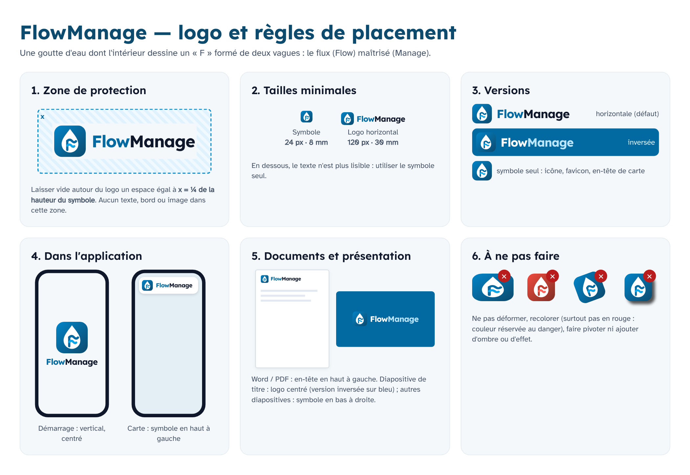

# Identité visuelle FlowManage

## Le logo

Une **goutte d'eau** dont l'intérieur dessine un **« F » formé de deux vagues** : le flux d'eau (*Flow*) que l'on maîtrise (*Manage*).

- **Symbole** : carré aux coins arrondis en dégradé bleu (`#0284C7` → `#0C4A6E`), goutte blanche, F en bleu `#0369A1` et bleu clair `#0EA5E9`.
- **Logotype** : « **Flow** » en bleu `#0369A1` + « **Manage** » en bleu nuit `#0F172A`, police **Lexend Bold**, approche resserrée (−3 %).
- **Signature** : « Anticiper, alerter, protéger. » en Atkinson Hyperlegible, gris `#475569`.

## Fichiers

| Fichier | Usage |
|---|---|
| `flowmanage-symbole.svg` | Symbole vectoriel (toutes tailles, impression) |
| `flowmanage-symbole-1024.png` | Symbole en image (réseaux sociaux, avatar) |
| `flowmanage-horizontal.png` | **Version par défaut** : documents, site, en-têtes |
| `flowmanage-horizontal-inverse.png` | Sur fond bleu `#0369A1` (couverture, diapositive de titre) |
| `flowmanage-vertical.png` | Écran de démarrage, affiche, couverture de rapport |
| `flowmanage-logotype.png` | Texte seul, quand le symbole est déjà présent à côté |

Les icônes de l'application (`icon.png`, icônes Android adaptatives, écran de démarrage, favicon) sont dans `mobile/assets/` (branche `frontend-mobile`), et le symbole est dessiné dans le code par `mobile/src/components/Logo.tsx`.

## Règles de placement

1. **Zone de protection** : laisser vide un espace égal à **x = ¼ de la hauteur du symbole** tout autour du logo.
2. **Tailles minimales** : symbole **24 px / 8 mm** ; logo horizontal **120 px / 30 mm**. En dessous, utiliser le symbole seul.
3. **Fonds** : sur blanc ou fond clair → version normale ; sur bleu `#0369A1` → version inversée. Jamais sur une photo chargée sans bandeau uni.
4. **Où le placer**

| Support | Version | Position |
|---|---|---|
| Icône de l'application | symbole | plein cadre (le système arrondit les coins) |
| Écran de démarrage | vertical | centré |
| Écran de connexion | symbole inversé + nom | centré dans le bandeau bleu du haut |
| Carte (écran principal) | symbole + nom | en-tête flottant, en haut à gauche |
| Word / PDF | horizontal | en-tête, en haut à gauche ; couverture : vertical centré |
| Présentation | inversé (titre), symbole (autres) | diapositive de titre : centré ; autres : symbole en bas à droite |
| Réseaux sociaux | symbole | avatar carré |

5. **À ne pas faire** : déformer, recolorer (surtout **pas en rouge**, couleur réservée au danger et au SOS dans l'application), faire pivoter, ajouter une ombre ou un contour, séparer le symbole et le texte autrement qu'avec les versions prévues, écrire « Flow manage » ou « Flowmanage » : le nom s'écrit **FlowManage**.
